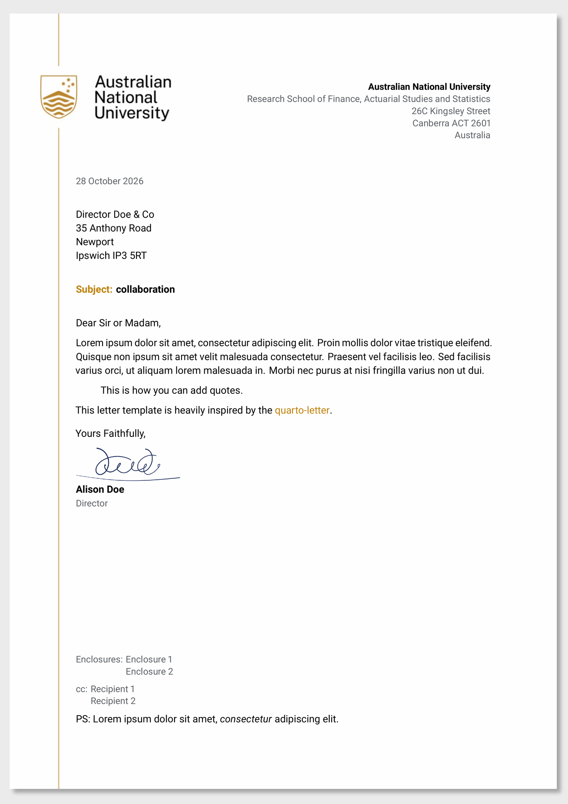

<!-- README.md is generated from README.qmd. Please edit that file -->

# Quarto template for ANU Letter

This repository contains a [Quarto](https://quarto.org) template for writing
letters on Australian National University (ANU) letterhead. You write the
letter in Markdown, set the sender, recipient and other details in the YAML
header, and Quarto renders it to a PDF with the ANU crest, gold side rule and
a clean, modern layout. The letter can be rendered with either LaTeX or
[Typst](https://typst.app), and both give the same layout.

```{r}
#| include: false

# Create pdf and png version of template
library(quarto)
library(magick)
# Render template
quarto_render(input = "template.qmd", output_format = "quarto-anu-letter-pdf")

# Convert rendered PDF to PNG
image_read_pdf("template.pdf") |>
  image_montage(geometry = "x2000+25+35",
                tile = "1x1",
                bg = "grey92",
                shadow = TRUE) |>
  image_convert(format = "png") |>
  image_write("examples/template-pdf.png")
# Move pdf to examples folder
fs::file_move("template.pdf", "examples/template.pdf")

# Render Typst version of template (this also writes to template.pdf before
# renaming it, so it runs after the LaTeX version has been moved)
quarto_render(input = "template.qmd", output_format = "quarto-anu-letter-typst",
              output_file = "template-typst.pdf")
fs::file_move("template-typst.pdf", "examples/template-typst.pdf")
```

[](examples/template.pdf)

The image above is the LaTeX version. The
[Typst version](examples/template-typst.pdf) looks the same.

## Features

- ANU crest and gold rule on the first page, with a lighter background on
  following pages
- Sender address block aligned to the right of the crest
- Optional subject line, sender position, signature image, enclosures, cc list
  and postscript
- Support for multiple signatories
- A4 paper, Roboto sans-serif font and ANU gold accents
- Page numbers ("Page 2 of 3") from the second page onwards
- Two formats with the same layout: `quarto-anu-letter-pdf` (LaTeX) and
  `quarto-anu-letter-typst` (Typst)

## Requirements

- [Quarto](https://quarto.org/docs/get-started/) 1.4 or later. The Typst
  format needs a version of Quarto that comes with Typst 0.12 or later (it has
  been tested with Quarto 1.9, which includes Typst 0.13). You can check with
  `quarto typst --version`.
- For the LaTeX format only, a LaTeX distribution. If you don't have one, the
  easiest option is TinyTeX:

  ```bash
  quarto install tinytex
  ```

  TinyTeX installs any missing LaTeX packages (such as the Roboto font)
  automatically the first time you render.

The Typst format needs nothing else: Typst comes with Quarto, and the Roboto
font is included in the extension.

## Installing

To start a new letter from the template, run:

```bash
quarto use template anuopensci/quarto-anu-letter
```

This creates a new directory containing `template.qmd` and the
`_extensions/` folder. Rename `template.qmd` to whatever you like and edit it.

To add the format to an existing project instead, run:

```bash
quarto add anuopensci/quarto-anu-letter
```

and set `format: quarto-anu-letter-pdf` (or `quarto-anu-letter-typst`) in the
YAML header of your document.

## Usage

Write the body of the letter in Markdown below the YAML header, then render it:

```bash
quarto render template.qmd
```

A minimal letter looks like this:

```yaml
---
format: quarto-anu-letter-pdf
author:
  - name: Alison Doe
    position: Director
    affiliation:
      - name: Australian National University
        department: Research School of Finance, Actuarial Studies and Statistics
        address: "26C Kingsley Street"
        city: Canberra ACT
        country: Australia
        postal-code: 2601
address:
  - Director Doe & Co
  - 35 Anthony Road
  - Newport
  - Ipswich IP3 5RT
subject: collaboration
opening: "Dear Sir or Madam,"
closing: "Yours faithfully,"
---

The body of the letter goes here.
```

### LaTeX or Typst

The template renders with LaTeX by default. To use Typst instead, change the
format in the YAML header:

```yaml
format: quarto-anu-letter-typst
```

or keep the header as it is and choose the format when you render:

```bash
quarto render template.qmd --to quarto-anu-letter-typst
```

Both formats take the same options and produce the same layout. Typst renders
faster and doesn't need a LaTeX installation, while the LaTeX format lets you
add your own LaTeX packages and commands.

## Options

The options below work the same way in both formats.

### Sender

The sender is set with `author`. The name and position appear in the
signature, and the first affiliation appears in the address block at the top
of the letter.

| Field                         | Description                                                |
|-------------------------------|------------------------------------------------------------|
| `name`                        | Sender's name, shown in bold in the signature.             |
| `position`                    | *Optional.* Job title, shown in grey below the name.       |
| `signature`                   | *Optional.* Path to an image of the signature (e.g. a PNG with a transparent background), shown above the name. |
| `affiliation`: `name`         | Organisation name, shown in bold at the top of the letter. |
| `affiliation`: `department`   | *Optional.* School, college or department.                 |
| `affiliation`: `address`      | *Optional.* Street address.                                |
| `affiliation`: `city`         | City and state, e.g. `Canberra ACT`.                       |
| `affiliation`: `postal-code`  | Postcode, printed after the city.                          |
| `affiliation`: `country`      | *Optional.* Country.                                       |

The `signature.png` included with the template is a made-up example. Replace
it with a scan of your own signature, cropped closely and ideally with a
transparent background. It is scaled to 1.3cm high.

To have more than one person sign the letter, list several authors. Each
author gets their own signature block, and each author's first affiliation is
listed in the address block at the top.

### Letter

| Field            | Description                                                                         |
|------------------|-------------------------------------------------------------------------------------|
| `address`        | Recipient's name and address, one line per list item.                              |
| `date`           | Date of the letter. Defaults to `today`.                                            |
| `date-format`    | Format of the date. Defaults to `"DD MMMM YYYY"` (e.g. 28 October 2026).           |
| `subject`        | *Optional.* Subject of the letter. Omit it to leave out the subject line entirely. |
| `subject-title`  | *Optional.* Label before the subject. Defaults to `Subject`.                        |
| `subject-suffix` | *Optional.* Text between the label and the subject. Defaults to `:`.               |
| `opening`        | Salutation, e.g. `"Dear Dr Smith,"`.                                               |
| `closing`        | Sign-off, e.g. `"Yours sincerely,"`.                                               |
| `encl`           | *Optional.* List of enclosures.                                                    |
| `cc`             | *Optional.* List of people receiving a copy.                                      |
| `ps`             | *Optional.* Postscript, shown at the end of the letter.                           |
| `title`          | Title stored in the PDF metadata. It is not printed on the letter.                |

For example, to use "Re" instead of "Subject:":

```yaml
subject: Your application
subject-title: Re
subject-suffix: ":"
```

## Customising

All the styling lives in `_extensions/quarto-anu-letter/`:

- `_extension.yml` defines both formats. For LaTeX it sets the paper size,
  margins, font, colours and the layout of the top of the letter (the
  `\opening` command). For Typst it sets the paper size, margins and font.
- The LaTeX format is built on the LaTeX `letter` class:
  - `partials/before-body.tex` sets up the signature, sender address and
    subject.
  - `partials/after-body.tex` adds the closing, enclosures, cc list and
    postscript.
  - `partials/_authors.tex` formats the sender's address block.
- The Typst format is defined in two files:
  - `partials/typst-template.typ` lays out the letter and sets the colours.
  - `partials/typst-show.typ` passes the options from the YAML header to the
    template.
- `fonts/` holds the Roboto font files used by the Typst format.
- `assets/images/` holds the background images for the first page
  (`coverpage.jpg`) and the following pages (`page-background.jpg`).

You can also override most format options from your document's YAML header
without editing the extension. For example, to change the margins in the
LaTeX format:

```yaml
format:
  quarto-anu-letter-pdf:
    geometry:
      - "margin=2.5cm"
```

and in the Typst format:

```yaml
format:
  quarto-anu-letter-typst:
    margin:
      x: 2.5cm
      y: 2.5cm
```

The Typst format also accepts Quarto's `papersize`, `mainfont` and `fontsize`
options.

## Acknowledgements

This template is heavily inspired by
[quarto-letter](https://github.com/mcanouil/quarto-letter) by Mickaël Canouil.

The Typst format includes the [Roboto](https://fonts.google.com/specimen/Roboto)
font by Google, which is licensed under the Apache License 2.0 (see
`_extensions/quarto-anu-letter/fonts/LICENSE`).
